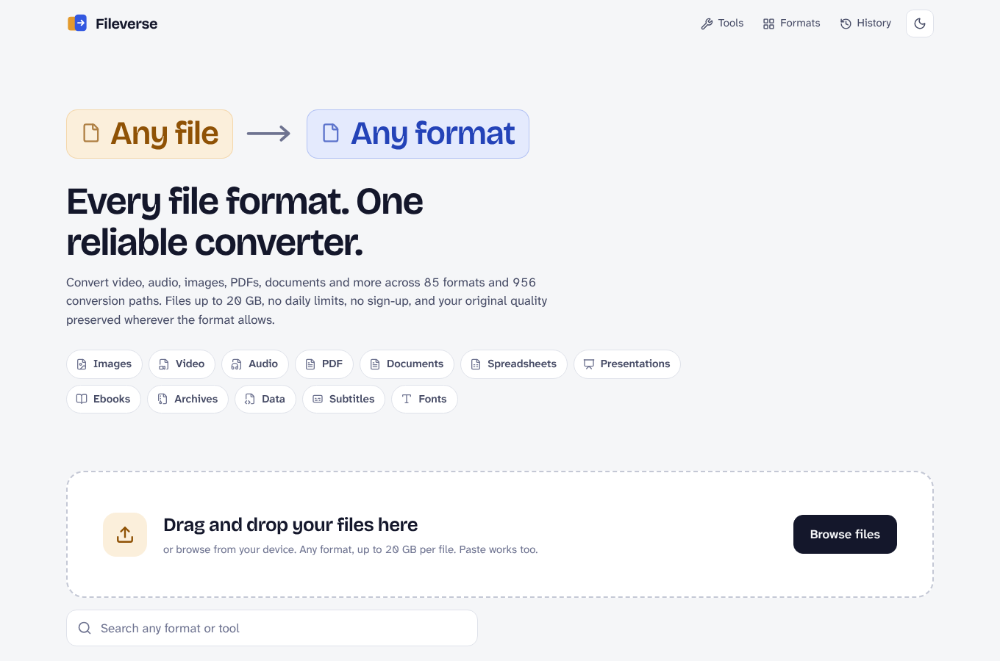
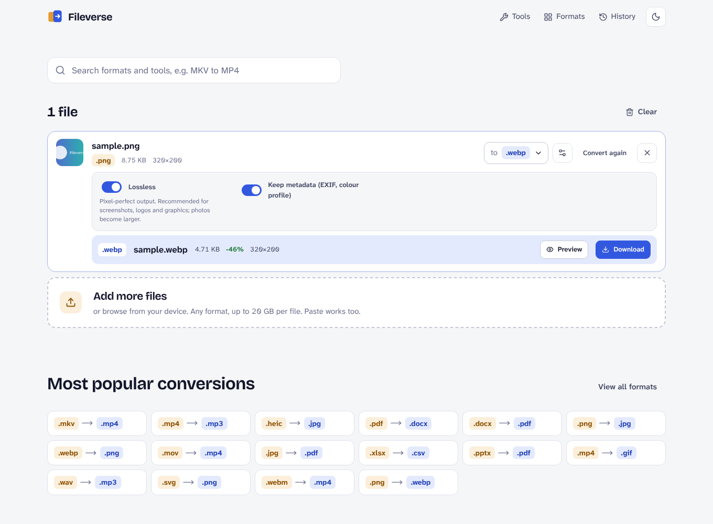
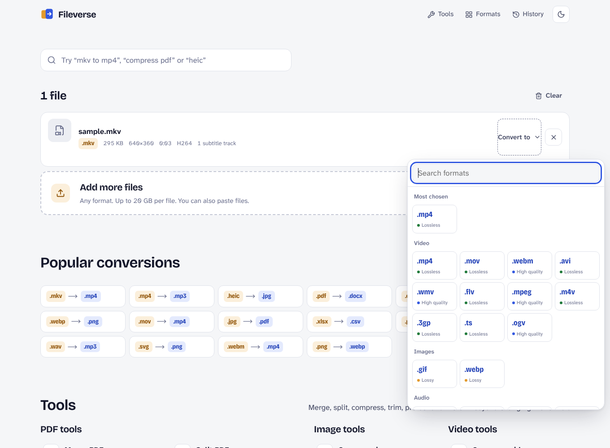
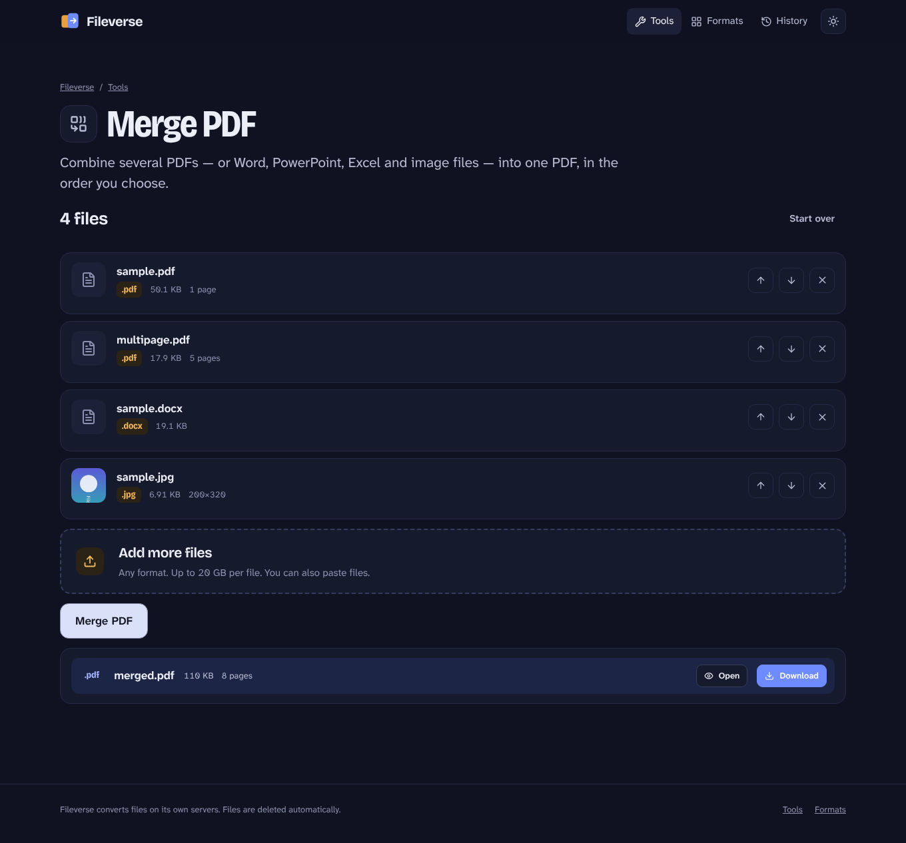

# Fileverse

**One place to convert any file to any format — no daily limits, multi-gigabyte files, original quality.**

Fileverse is a self-hosted, production-ready file conversion platform: a web app, an API and a set of
conversion engines (FFmpeg, libvips, LibreOffice, Ghostscript, qpdf, Tesseract OCR, Pandoc, Calibre,
7-Zip, FontForge) behind one simple interface.

| | |
|---|---|
| Formats | **85** across 12 categories |
| Conversion paths | **≈ 960** (direct, plus quality-safe two-step routes) |
| Tools | **19** — merge/split/compress/OCR/protect PDFs, compress/resize images, compress/trim video and audio, create/extract archives |
| Largest file tested | **6.06 GB** MKV → MP4 in 18 s, no re-encoding, server memory peak 151 MB |
| Automated checks | **899** conversions validated end-to-end, **42** tool/platform tests, **56** measured quality checks |



| Converter | Format picker | Dark mode |
|---|---|---|
|  |  |  |

## What makes it different

- **No artificial limits.** No daily caps, no account, no paywall. A fair queue (per-browser concurrency, not a quota) keeps one heavy user from blocking others.
- **Built for huge files.** Uploads use the resumable [tus](https://tus.io) protocol in 50 MB chunks: nothing is held in browser or server memory, dropped connections resume, and it works behind Cloudflare's 100 MB request limit. Downloads stream with HTTP range support.
- **Quality first, and measured.** Video and audio streams are *copied* when the target container accepts them (MKV→MP4 is a bit-exact remux). Lossless routes are verified pixel/sample-identical. When quality must change, the interface says why before you convert, and re-encodes are visually lossless (SSIM ≥ 0.99 in tests).
- **Honest.** Every conversion shows a one-line quality note ("No re-encoding: streams copied bit-for-bit", "JPG has no transparency…"). Unsupported cases (RAR creation, DRM ebooks) are explained, not hidden.
- **Private by default.** Files are tied to an anonymous browser session, never listed publicly, and deleted automatically (2 hours by default).

## Quick start

### Docker (recommended — includes every engine)

```bash
docker build -t fileverse .
docker run -d --name fileverse -p 8080:8080 -v fileverse-data:/data fileverse
# open http://localhost:8080
```

Online for free with HTTPS, without installing anything locally: **[docs/FREE-HOSTING-GUIDE.md](docs/FREE-HOSTING-GUIDE.md)**.

### Local development

Requirements: Node.js ≥ 22.13 and the engines you want (Ubuntu: see the package list in the `Dockerfile`).
Missing engines are detected at start-up and their conversions are simply hidden.

```bash
cd server && npm install && npm run dev        # API + workers on :8080
cd web && npm install && npm run dev           # web app on :5173 (proxies /api to :8080)
```

Production build of the web app: `cd web && npm run build` — the server then serves `web/dist` itself.

## Tests

```bash
cd server
npm run test:fixtures            # generates one real sample file per format (needs the engines)
npm run test:matrix              # runs EVERY offered conversion and validates each output independently
npm run test:e2e                 # tools, OCR, passwords, resumable upload, cancel, range downloads, isolation
npm run test:quality             # bit-exact copies, pixel/sample-identical lossless routes, SSIM of re-encodes
npm run test:bigfile -- /path/to/huge.mkv mp4
```

All suites talk to a running server through the real HTTP API (`FILEVERSE_URL`, default `http://localhost:8080`).

## Project structure

```
server/                 Node.js API + conversion workers (no build step)
  src/config.js         every setting, from environment variables
  src/registry/         format catalog, converter registry, route planner, option validation
  src/converters/       video, audio, subtitle, image, office, pdf, pandoc, ebook, data, font, archive
  src/tools/            PDF, image, media and archive tools
  src/engines/          wrappers for FFmpeg, libvips/ImageMagick, LibreOffice, 7-Zip/tar …
  src/jobs/             SQLite job queue, fair scheduler, runner, workers
  src/http/             Express app, tus uploads, REST API, live events (SSE)
  scripts/              Python helpers (PDF→Word, PDF tables, PPTX, fonts, OCR text)
  test/                 fixture generator + end-to-end, matrix, quality and large-file suites
web/                    React + TypeScript single-page app (Vite)
deploy/                 Caddyfile, ImageMagick policy, env example
docs/                   ARCHITECTURE.md, DEPLOYMENT.md, CONFIGURATION.md
```

## Documentation

- [docs/ARCHITECTURE.md](docs/ARCHITECTURE.md) — how it works, quality policy, adding a converter
- [docs/FREE-HOSTING-GUIDE.md](docs/FREE-HOSTING-GUIDE.md) — **put it online for free, in the browser only (step by step)**
- [docs/DEPLOYMENT.md](docs/DEPLOYMENT.md) — free and paid hosting, domains, HTTPS, Cloudflare, scaling
- [docs/CONFIGURATION.md](docs/CONFIGURATION.md) — every environment variable
- [docs/FORMATS.md](docs/FORMATS.md) — every format, conversion and tool
